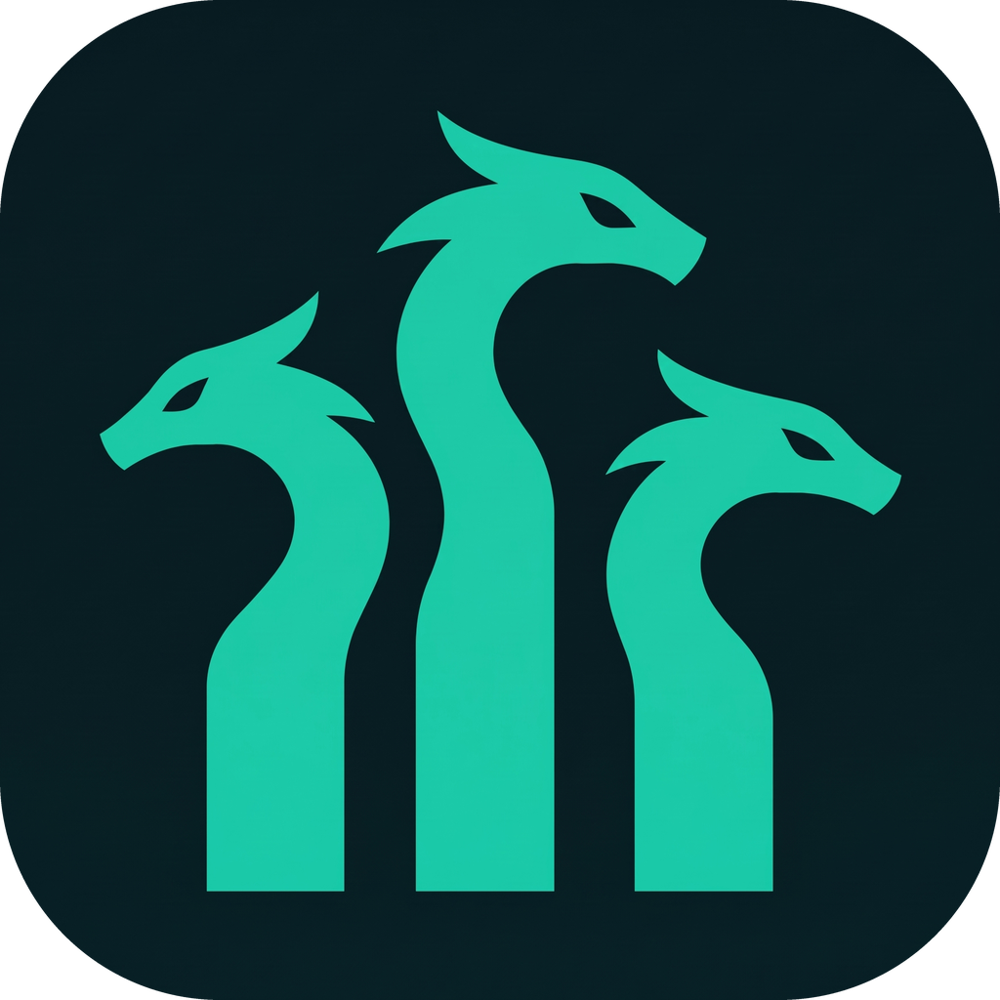

<p align="center"></p>

# Hydra

An Apple Music desktop client for Linux, a fork of [Sidra](https://github.com/wimpysworld/sidra).

Hydra is source code only. There are no releases, downloads or package repositories, so you build it yourself.

## Build from source

You need Node 24 and [just](https://github.com/casey/just). They can live in a local `.tools/` folder, which git ignores, with a `.tools/env.sh` that puts them on your `PATH` for the current terminal:

```bash
# .tools/env.sh
ROOT="$(cd "$(dirname "${BASH_SOURCE[0]}")/.." && pwd)"
export PATH="$ROOT/.tools/node/bin:$ROOT/.tools/bin:$PATH"
export npm_config_cache="$ROOT/.tools/npm-cache"
```

Then:

```bash
source .tools/env.sh
npm ci
just test
just run
```

`just run` uses the same settings folder as an installed copy, so quit the installed app first or the new one exits straight away.

To install it system-wide on Linux amd64, build a `.deb` and install that:

```bash
just build
npx electron-builder --linux deb --x64 --publish never
sudo apt install ./release/Hydra-*-linux-amd64.deb
```

## What this fork adds

- **Performance mode:** removes Apple's heavy blur layers, which make dragging the window lag. On by default; toggle it in Settings.
- **Top bar:** replaces Apple's sidebar with a slim bar, once you are signed in: Back on the left, a floating pill with Home, Search, Vibe and All Playlists in the centre, and Settings and an account menu on the right. Its "Sign out…" takes you to Apple's sidebar, where Apple's own Sign Out is. Ctrl+B or Settings switches back to Apple's sidebar for Library, Radio and Pins.
- **Songs-first search:** Ctrl+K or the bar's Search button opens a search that lists songs only, with the artist's own songs first; click one to play it and queue the rest. "All results in Apple Music" opens Apple's full search.
- **Remembers the window:** Hydra reopens at the size and place you left it, maximised included, and moves onto a connected monitor if that one has gone. Turn on Close to tray (tray menu or Settings) and closing the window keeps the music playing; Show Window in the tray menu, or launching Hydra again, brings it back where it was.
- **Last.fm scrobbling:** connect your account in Settings and Hydra scrobbles every song you play past half its length or four minutes, radio included, with Now Playing on your profile. Plays made offline are kept and sent when Last.fm can be reached again. Hydra ships without Last.fm API credentials, so create your own free API account at [last.fm/api/account/create](https://www.last.fm/api/account/create) and save its key and shared secret as `~/.config/Hydra/lastfm.json`: `{ "apiKey": "…", "apiSecret": "…" }`, or set `HYDRA_LASTFM_API_KEY` and `HYDRA_LASTFM_API_SECRET`. Restart Hydra and Last.fm appears in Settings. Your session key is kept in the system keyring; without one you connect again each launch.
- **Vibe:** a music chat in a side panel, opened from the ✦ button in the player bar or the top bar. Ask for a mood ("late night drive, Travis Scott energy but stuff I haven't heard"), an artist or a set, in English or Albanian, and Claude answers briefly with songs from the Apple Music catalogue, each with a one-line reason. Click a song to play the set from there, use its menu to play it next or add it to the queue, or Play all; Ask for a playlist and Claude proposes one as a preview: it is created in your library only when you press **Create playlist**, and Vibe can never change or delete an existing playlist. Claude never starts anything itself. Every song is looked up in the real catalogue before it is shown. Vibe uses your own Anthropic API key, entered in Settings and kept in the system keyring (without one, until Hydra quits; Settings names the store, such as GNOME Keyring), and Claude Haiku 5.5 or Claude Sonnet 5.5. Your messages go to Anthropic; Claude can also ask for the song playing now and the artists and titles of your last 20 songs. The chat is kept in memory only, until New chat, a reload or quitting. Messages run one at a time, and stop for the day once they have spent the daily budget you set in Settings ($2 by default). Settings and the panel show the day's spend, estimated from Anthropic's list prices; your Anthropic Console has the real bill. Without a key Vibe sends nothing; to remove it altogether, turn off **Use Vibe** in Settings.
- **Playlist sorting:** a Sort button above any playlist's songs, library or Apple Music, sorts by title, artist, album, duration or the playlist's own order, either way round. Hydra then shows its own list under "Sorted by … · Reset", and Apple's Play plays it in that order. Each playlist remembers its sort. Apple's music service gives no date added for playlist songs, so there is no date sort; the playlist's own order, descending, puts the newest additions first in a playlist that grows at the end.
- **No update checks:** the app never contacts upstream for updates and never replaces itself.

## Credits

Based on Sidra by Martin Wimpress ([wimpysworld](https://github.com/wimpysworld)): <https://github.com/wimpysworld/sidra>.

Licensed under the [Blue Oak Model License 1.0.0](LICENSE) (BlueOak-1.0.0).
